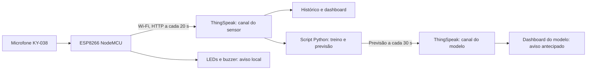

# NoiseGuard – Monitor de Ruído com IoT e Aprendizado de Máquina

Trabalho Prático **Agentes, IoT e Aprendizado de Máquina** · IFSULDEMINAS – Campus Machado · Prof. Matheus Franco

**Equipe:** [NOMES DOS INTEGRANTES]

O NoiseGuard é um agente de hardware baseado em **ESP8266 (NodeMCU)** que mede o nível sonoro de um ambiente, compara com um limite de referência, avisa no local com LEDs e buzzer, envia as medições para a nuvem (**ThingSpeak**), mantém um histórico, exibe tudo em uma dashboard e usa um **Random Forest** para estimar se o ambiente ultrapassará o limite nos próximos 2 minutos.

> **Aviso importante.** O sensor usado (KY-038) **não é um sonômetro calibrado**. O projeto mede nível sonoro **relativo** e estima decibéis de forma aproximada. Ele serve como **pré-triagem** e **não substitui** a medição oficial nem tem valor de prova legal.

---

## Sumário

- [Como funciona](#como-funciona)
- [Hardware](#hardware)
- [Estrutura do repositório](#estrutura-do-repositório)
- [Como rodar](#como-rodar)
- [Dados armazenados](#dados-armazenados)
- [Aprendizado de máquina](#aprendizado-de-máquina)
- [Resultados](#resultados)
- [Limitações](#limitações)
- [Melhorias futuras](#melhorias-futuras)
- [Segurança das chaves](#segurança-das-chaves)
- [Referências](#referências)

---

## Como funciona



1. O ESP8266 lê o pino `A0` em janelas de 50 ms e calcula a **amplitude** do sinal (máximo menos mínimo).
2. A cada 1 s, o pico do último segundo é convertido em dB aproximado e classificado:

   | Estado | Faixa (dB estimado) | Aviso local |
   |---|---|---|
   | 0 – dentro do limite | abaixo de 60 | LED verde |
   | 1 – próximo do limite | de 60 a 65 | LED amarelo |
   | 2 – acima do limite | 65 ou mais | LED vermelho e bip |

3. A cada 20 s, o ESP8266 envia ao ThingSpeak um resumo da janela (média dos picos, pico máximo, dB estimado, estado e RSSI do Wi-Fi). O intervalo respeita o mínimo de 15 s do plano gratuito.
4. Leituras travadas em 0 ou 1023 (sensor solto) são descartadas, e o dado não é enviado se houver janelas inválidas demais.
5. O script `noiseguard_ml.py` lê o histórico, treina o Random Forest e, no modo `aovivo`, publica a previsão em um segundo canal.

**Limite de referência:** 65 dB, que é o limite diurno da NBR 10151:2019 para áreas com atividades culturais, lazer e turismo, com margem de 5 dB para o estado "próximo". Leis municipais podem fixar valores diferentes; o limite é um parâmetro do código.

### Calibração aproximada (amplitude para dB)

```
dB ≈ 8,8 + 30,3 · log10(amplitude)     (mínimo de 30 dB)
```

| Situação | Amplitude | dB estimado | Origem |
|---|---|---|---|
| Silêncio | 4 a 5 | ≈ 30 | app de decibelímetro no celular |
| Palma a ~10 cm | ≈ 98 | ≈ 69 | calculado pela fórmula |
| Caixa de som no máximo, a 30 cm | até ≈ 700 | ≈ 95 | **valor assumido** |

A calibração **não foi validada** com instrumento certificado.

---

## Hardware

| Item | Quantidade |
|---|---|
| NodeMCU (ESP8266) e cabo USB | 1 |
| Módulo de som KY-038 | 1 |
| LED verde, amarelo e vermelho | 1 de cada |
| Resistor de 220 Ω | 3 |
| Buzzer | 1 |
| Protoboard e jumpers | alguns |

### Ligações

| Componente | Pino do componente | NodeMCU |
|---|---|---|
| KY-038 | AO | A0 |
| KY-038 | + (VCC) | 3V3 |
| KY-038 | G | GND |
| LED verde | anodo, via resistor de 220 Ω | D5 |
| LED amarelo | anodo, via resistor de 220 Ω | D2 |
| LED vermelho | anodo, via resistor de 220 Ω | D1 |
| LEDs | catodo | GND |
| Buzzer | + | D6 |
| Buzzer | − | GND |

O KY-038 é alimentado em **3,3 V** para que a saída analógica não ultrapasse o limite do pino `A0`. A sensibilidade é ajustada no potenciômetro (caixinha azul) do módulo.


---

## Estrutura do repositório

Estrutura sugerida (ajuste os nomes aos arquivos reais):

```
.
├── README.md
├── requirements.txt
├── .gitignore
├── firmware/
│   └── noiseguard_esp8266/
│       └── noiseguard_esp8266.ino     # código do ESP8266
├── ml/
│   ├── noiseguard_ml.py               # treino, avaliação e previsão ao vivo
│   ├── modelo_rf.joblib               # modelo treinado (gerado)
│   ├── resultados_teste.csv           # previsões no conjunto de teste (gerado)
│   ├── matriz_confusao.png            # gerado
│   └── importancia_features.png       # gerado
├── data/
│   └── feeds_547.csv                  # dados usados no treino
└── docs/
    ├── relatorio.pdf
    └── img/                           # fotos e prints da dashboard
```

---

## Como rodar

### 1. Firmware (ESP8266)

1. Instale o **Arduino IDE 2.x**.
2. Em *Arquivo, Preferências*, acrescente em *URLs Adicionais para Gerenciadores de Placas*:
   `http://arduino.esp8266.com/stable/package_esp8266com_index.json`
3. Em *Ferramentas, Placa, Gerenciador de Placas*, instale **esp8266 by ESP8266 Community** e selecione **NodeMCU 1.0 (ESP-12E Module)**.
4. Abra `firmware/noiseguard_esp8266/noiseguard_esp8266.ino` e preencha, **somente na sua cópia local**:

   ```cpp
   const char* WIFI_SSID  = "NOME_DA_SUA_REDE";      // rede 2,4 GHz
   const char* WIFI_SENHA = "SENHA_DA_SUA_REDE";
   const char* API_KEY    = "WRITE_API_KEY_DO_CANAL_DO_SENSOR";
   ```

5. Grave na placa e abra o Monitor Serial em **115200**. Você deve ver `Wi-Fi conectado` e, a cada 20 s, `[envio] HTTP 200 | entrada N`.

> O ESP8266 só conecta em redes **2,4 GHz**. Redes que exigem login por página ou usuário e senha (como algumas de campus) não funcionam. Um hotspot de celular em 2,4 GHz resolve.

### 2. ThingSpeak

Crie dois canais.

**Canal do sensor:**

| Campo | Nome | Conteúdo |
|---|---|---|
| Field 1 | `amp_media` | média dos picos por segundo na janela de 20 s |
| Field 2 | `amp_max` | maior pico de amplitude na janela de 20 s |
| Field 3 | `db_estimado` | dB estimado a partir de `amp_max` |
| Field 4 | `estado_baseline` | 0 dentro, 1 próximo, 2 acima |
| Field 5 | `rssi_wifi` | intensidade do Wi-Fi (dBm) |

O campo *status* de cada registro recebe o identificador do dispositivo (`NODEMCU-01`), e a data e hora vêm do servidor (UTC).

**Canal do modelo:**

| Campo | Nome | Conteúdo |
|---|---|---|
| Field 1 | `classe_prevista` | estado previsto para daqui a 2 minutos (0, 1 ou 2) |
| Field 2 | `prob_acima_pct` | probabilidade, em %, de o estado ser "acima" |
| Field 3 | `estado_atual` | estado medido no momento da previsão |

Dashboard sugerida: gauge e display numérico do dB, lâmpada de estado, gráficos de dB, pico de amplitude, estado e RSSI, e no canal do modelo a lâmpada da classe prevista e o gauge da probabilidade.

Canais desta entrega: sensor `3563308` e modelo `3575825`.

### 3. Aprendizado de máquina (Python)

```bash
pip install -r requirements.txt
cd ml
```

**Treinar e avaliar com os dados usados no trabalho** (reprodutível):

```bash
python noiseguard_ml.py treinar --csv ../data/feeds_547.csv
```

Para baixar o histórico atual direto do ThingSpeak (os resultados mudam conforme entram dados novos):

```bash
python noiseguard_ml.py treinar --canal 3563308
```

Se o canal do sensor for privado, acrescente `--read-key SUA_READ_API_KEY`.

**Previsão ao vivo** (envia a previsão ao canal do modelo):

```powershell
# Windows (PowerShell)
$env:THINGSPEAK_ML_WRITE_KEY="WRITE_API_KEY_DO_CANAL_DO_MODELO"
python noiseguard_ml.py aovivo --canal 3563308
```

```bash
# Linux ou macOS
export THINGSPEAK_ML_WRITE_KEY="WRITE_API_KEY_DO_CANAL_DO_MODELO"
python noiseguard_ml.py aovivo --canal 3563308
```

O modo `aovivo` exige **5 minutos de histórico contínuo** (sem buracos maiores que 90 s) e não publica se o ESP8266 ficar mais de 2 minutos sem enviar dados. Ele carrega o `modelo_rf.joblib` ao iniciar, então reinicie-o após treinar de novo.

---

## Dados armazenados

Cada registro guarda data e hora, valores medidos, unidade (dB estimado e unidades do conversor analógico-digital), estado e identificação do dispositivo. O histórico fica no ThingSpeak e pode ser exportado em CSV; o arquivo `data/feeds_547.csv` contém os 547 primeiros registros do canal do sensor, usados no treino. A coleta foi feita com música em volumes variados, palmas e períodos de silêncio.

---

## Aprendizado de máquina

| Item | Escolha |
|---|---|
| Tarefa | aviso antecipado por classificação |
| Alvo | estado sonoro (0, 1 ou 2) **daqui a 2 minutos** (6 registros à frente) |
| Características (17) | dB, amplitude média e máxima, variação em relação ao registro anterior; média, máximo, desvio padrão e número de picos (dB ≥ 60) em janelas de 1, 3 e 5 minutos; tendência (média de 1 minuto menos a de 5) |
| Preparação | remoção de registros incompletos, fora da faixa e duplicados; separação em sessões contínuas (buracos > 90 s); janelas e alvo calculados dentro de cada sessão |
| Divisão | temporal 80/20, sem embaralhar; as 6 últimas linhas do treino são descartadas para evitar vazamento |
| Modelo | Random Forest, 300 árvores, mínimo de 3 amostras por folha, pesos de classe balanceados, semente 42 |
| Baselines | (1) limiar fixo de 65 dB aplicado ao estado atual; (2) classe mais comum do treino |
| Métricas | acurácia, F1 macro, precisão e recall da classe "acima", matriz de confusão |

---

## Resultados

Execução principal (547 registros válidos; 98 amostras de teste: 38 dentro, 16 próximo, 44 acima):

| Modelo | Acurácia | F1 macro | Precisão "acima" | Recall "acima" |
|---|---|---|---|---|
| Classe mais comum | 0,388 | 0,186 | 0,000 | 0,000 |
| Baseline (limiar fixo) | 0,480 | 0,404 | 0,531 | 0,591 |
| Random Forest | 0,296 | 0,281 | 0,413 | 0,432 |

**Nesta base, o Random Forest não superou o baseline.** Rodadas posteriores com mais dados (até 763 registros) tiveram um teste quase todo "dentro" (110 de 126 amostras, com 1 "próximo" e 15 "acima"), no qual a classe mais comum teve acurácia de 0,873, o baseline 0,786 e o Random Forest 0,317 (recall "acima" de 0,67 e precisão de 0,11). A conclusão se mantém.

Hipóteses para o resultado (não testadas neste trabalho): amostra de teste pequena, mudança de regime entre treino e teste, e dependência do som futuro de decisões humanas em dados encenados.


---

## Limitações

- Sensor não calibrado e dependente do ajuste do potenciômetro; calibração em dB simulada e não validada.
- Um único ponto de medição, sem ponderação em frequência (dB(A)) e sem o tempo de integração normativo.
- Limite fixo (65 dB, diurno), sem alternância entre dia e noite ou entre zonas.
- Dados coletados em cenário controlado, e não em um evento real.
- Plano gratuito do ThingSpeak: no mínimo 15 s entre envios por canal.
- Tráfego HTTP sem criptografia.

## Melhorias futuras

- Microfone calibrado (por exemplo, MEMS) com calibração em sonômetro certificado e ponderação A.
- Limite automático por horário e tipo de zona.
- Coleta em eventos reais e avaliação por validação cruzada temporal, com sessões inteiras para teste.
- Horizontes menores, outros modelos (como gradient boosting) e regressão do nível futuro em dB.
- Alertas ativos (e-mail ou mensagem) quando a probabilidade de "acima" for alta.
- MQTT com TLS, banco de séries temporais e execução do modelo na nuvem.

---

## Segurança das chaves

**Nunca envie para o repositório** senhas de Wi-Fi nem Write/Read API Keys do ThingSpeak. Antes de fazer `git add` e `git push`, confira se o `.ino` está com os valores de exemplo (`NOME_DA_SUA_REDE`, `WRITE_API_KEY_DO_CANAL_DO_SENSOR`). O script Python lê a chave do canal do modelo da variável de ambiente `THINGSPEAK_ML_WRITE_KEY`, sem gravá-la em arquivo. Se uma chave for exposta, gere outra em *API Keys, Generate New Write API Key*.

Sugestão de `.gitignore`:

```
__pycache__/
*.pyc
.env
feeds_completo.csv
rodada_*/
```

`requirements.txt`:

```
pandas
numpy
scikit-learn
matplotlib
joblib
```

---

## Referências

- ABNT NBR 10151:2019 – Acústica: medição e avaliação de níveis de pressão sonora em áreas habitadas.
- ThingSpeak (MathWorks): documentação da API REST de escrita e leitura de canais.
- Scikit-learn: `RandomForestClassifier` e métricas de classificação.

